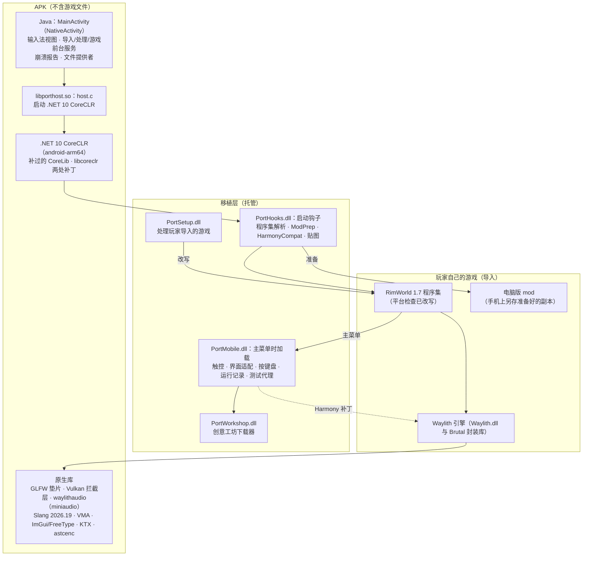
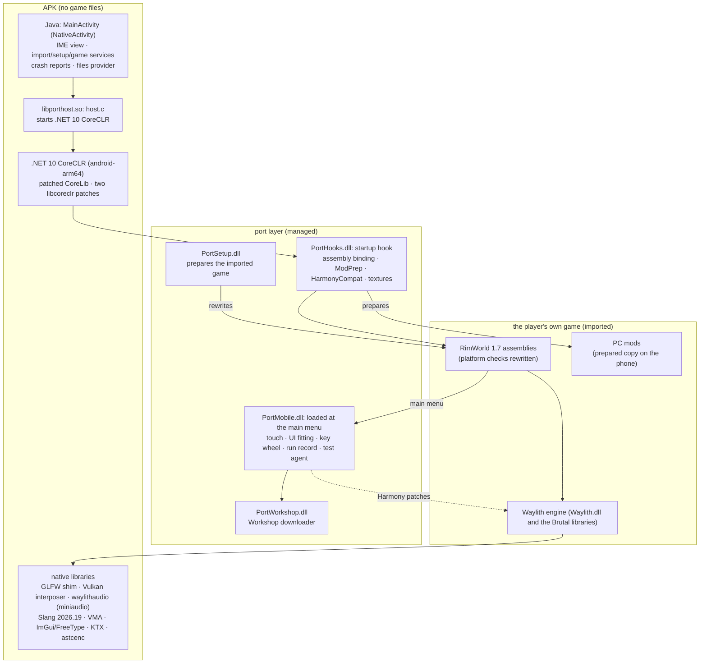

# Port17：RimWorld 1.7 安卓移植（非官方）

**中文** · [English](#english)

> 非官方玩家项目，与 Ludeon Studios 无关，也未经其认可。本仓库不含 RimWorld 的任何代码、素材或二进制文件，给玩家用的安卓安装包里也没有；运行需要玩家自己拥有的正版游戏。见文末[免责声明](#免责声明)。

Port17 让 RimWorld 1.7 在安卓手机上运行，电脑版的 mod 不用改就能用。1.7 把游戏从 Unity 搬到了 Ludeon 自研的 Waylith 引擎：一个 .NET 10 程序，用 Vulkan 渲染。电脑版跑在 Ludeon 修改过的 .NET 运行时上，手机上用的是微软发布的标准 .NET 10 CoreCLR for Android。本项目补上两者之间的差距：安卓宿主、平台层、引擎原生库的安卓版、运行时兼容开关的模拟、mod 在手机上的现场准备，以及一层为手指设计的触控和界面适配。

详细技术文档：[docs/TECHNICAL.md](docs/TECHNICAL.md)（中文）· 英文概要：[docs/OVERVIEW.en.md](docs/OVERVIEW.en.md)

## 开发者

- **samilry**：项目负责人。定目标、做决定、在真实手机上测试、发布。
- **Claude（Anthropic）**，通过 Claude Code 工作：承担了大部分工程工作，包括分析、设计、实现、测试工具和这份文档。

## 亮点（实测数字）

- **电脑版 mod 原样可用**：mod 文件一个字节都不改，手机在 mod 第一次加载前自动准备一份副本（ModPrep，规则第 14 版）。负责人自己用 130 多个 mod 的列表在手机上游玩；34 个热门界面 mod 的自动冒烟测试没有发现移植层报错。
- **在标准运行时上模拟 Ludeon 的运行时分支**：游戏配置里开着 20 个 `WaylithClr.*` 兼容开关（1.7.4995 又加了字段注入两项）。手机上照电脑运行时的实际行为，分别用 CoreLib 补丁、`libcoreclr.so` 的两处二进制补丁、mod 准备规则、Harmony 发射修补和防内联重建来模拟（只有一项没找到可测的差别，未模拟）。
- **1.7 + CoreCLR 对比早先的 1.6 移植版（Unity + IL2CPP）**：同一个原版百人存档、三倍速、帧率上限 60，31–36 FPS / 339–353 TPS → 57 FPS / 359 TPS；每个 tick 的主线程周期减半，界面每帧的周期少四分之三。
- **内存**：原版百人场景（进程 PSS + 显存）约 5.4 GB → 2.3 GB；106 个 mod 的场景约 7.4 GB → 4.4 GB。
- **着色器与电脑一致**：把电脑版用的 Slang 2026.19 编进安卓；372 个着色器的语料里，电脑能编的 371 个在手机上输出逐字节相同的 SPIR-V。
- **Mali GPU**：不能采样 BC 压缩贴图，先解码兜底，再在手机上转成 ASTC 4×4 并缓存（图集 821 MB，解成 RGBA 要约 3.3 GB）。
- **安装包不含游戏**：测试者安装包约 55 MB；玩家导入自己的游戏后在手机上现场处理，开发机上从选中游戏压缩包到主菜单 44 秒。
- **游戏内的创意工坊下载器**：用玩家自己的 Steam 登录，一个 146 个 mod 的合集（2.5 GB）约 17 分钟下载安装完，零失败。
- **约三周、438 次提交**（2026-10-13 至 11-02），期间跟进了 7 次游戏更新（1.7.4976 → 4995）。

## 架构

## 仓库结构

| 文件夹 | 内容 |
|---|---|
| `hooks/` | PortHooks.dll，CoreCLR 的启动钩子，在游戏 `Main` 之前运行：Unity 程序集名的解析、mod 准备的入口、Harmony 发射前的栈修补、贴图（BC 解码、ASTC）、显存预算、字体、缺失程序集替身、启动监视 |
| `mobile/` | PortMobile.dll，手机层，主菜单出现时加载：触控手势、点按辅助、列表滑动、窗口适配、按键盘与鼠标键、挖孔避让、帧率与调度、内存整理、运行记录、测试代理、mod 导入与排序 |
| `workshop/` | PortWorkshop.dll，游戏内的 Steam 创意工坊下载器（基于 SteamKit2），在单独的加载上下文里运行 |
| `patch/` | patch.dll，电脑端的 Cecil 改写器（平台检查、Harmony 的 bionic 适配、CoreLib 补丁、类型转发程序集、引用检查）；`ModPrep.cs` 是 mod 准备规则，和 PortHooks 共用一份源码 |
| `setup/` | PortSetup.dll，在手机上处理玩家导入的游戏副本（单独进程） |
| `host/` | 安卓宿主：`host.c`、Java 层、GLFW 垫片、Vulkan 拦截层、桩库；构建和推送脚本；MCP 驱动和测量脚本；第三方许可（`host/licenses/`） |
| `native/` | 引擎原生库的安卓构建：waylithaudio（miniaudio）、Slang 构建脚本和补丁、ImGui 扁平 C 接口生成器和补丁、VMA、KTX、astcenc、MonoMod 在 bionic 上的辅助库 |

## 玩家怎么用

1. 拥有 RimWorld 正版（Steam）。移植需要 1.7（写这份文档时它是 Steam 上的 "unstable" 测试分支）；1.6 的游戏文件夹导入不了。
2. 把自己电脑上的游戏文件夹（或打成的 zip）拷到手机上。
3. 安装测试者安装包。第一次启动时选中这个 zip 或文件夹：应用把它复制进自己的目录，在手机上处理（开发机上约 8 秒），然后进入主菜单。自己拥有的 DLC 一起导入。
4. mod：在 Mod 页用“导入Mod…”导入电脑上的 mod 文件夹或 zip，或者在游戏内的创意工坊窗口用自己的 Steam 账号下载。

要求：64 位 ARM（arm64-v8a）、Android 8.0 及以上、支持 Vulkan 的 GPU（Adreno、Mali 都可以）、导入时约 3 GB 空闲空间。

## 从源码构建（概要）

不是一键构建。脚本在 Windows 的 Git Bash 里运行，工具的路径写在各脚本开头，需要按自己的环境修改。

需要：

- 自己的 RimWorld 1.7 安装：脚本对着游戏的程序集编译，并从中准备 `build/game`；另需 Harmony mod 1.7 版的 `0Harmony.dll`；
- .NET 10 的安卓运行时包 `Microsoft.NETCore.App.Runtime.android-arm64` 10.0.12（NuGet），以及同一版本的 crossgen2；
- 电脑上的 .NET 运行时、Roslyn 编译器（`csc.dll`）、Mono.Cecil 0.11；工坊下载器用的 NuGet 库（SteamKit2、protobuf-net、QRCoder、ZstdSharp）；
- Android NDK（大部分库用 r23；Slang 要 C++20，用 r27c，并需要 Visual Studio 2022 先编它的代码生成器）、SDK build-tools 34、platform android-34、JDK、Node.js；
- 上游源码放在 `downloads/src`（清单见 `native/build.sh` 开头）。

步骤：

1. `patch/build.sh` 编 patch.dll；`native/build.sh` 编原生库（Slang 用 `native/slang/build-official.cmd`）。
2. `host/stage.sh build`：从自己的游戏准备 `build/game` 并改写程序集；用 `patch.dll --forwarders` 生成 Unity 程序集名的类型转发门面。
3. `hooks/build.sh`、`mobile/build.sh`、`workshop/build.sh`、`setup/build.sh`；`host/corelib.sh` 生成带兼容开关的 CoreLib。
4. `PAYLOAD=port host/build.sh` 生成 `build/port17-tester.apk`（不含游戏文件）。开发时也可以用 `host/build.sh` 打宿主 APK，再用 `host/stage.sh` 经 adb 把运行时和自己的游戏推到自己的手机上。

## 第三方组件与许可

| 组件 | 版本 | 许可 | 用途 |
|---|---|---|---|
| .NET 运行时（android-arm64）、System.IO.Hashing、BinaryFormatter 兼容包 | 10.0.12 / 10.0.0 | MIT | CoreCLR 与类库；CoreLib 按 Ludeon 的开关补过并重新预编译 |
| Harmony（Harmony mod 的 1.7 版 0Harmony.dll），内含 MonoMod、Iced | 3.0 | MIT | mod 的补丁框架；移植改写了它的少数调用 |
| Mono.Cecil | 0.11.6 | MIT | 程序集改写（电脑和手机上） |
| SteamKit2 | 3.4.0 | LGPL-2.1（未修改、单独的 DLL，可替换） | 创意工坊下载器 |
| protobuf-net / QRCoder / ZstdSharp（含 zstd） | 3.2.56 / 1.8.1 / 0.8.7 | Apache-2.0 / MIT / MIT（zstd：BSD） | 创意工坊下载器 |
| Vulkan Memory Allocator、Vulkan-Headers | 3.3.0 / 1.3.296 | MIT / Apache-2.0 或 MIT | libvma.so、Vulkan 拦截层 |
| Dear ImGui（docking）、FreeType | 1.92.2 / 2.13.3 | MIT / FreeType License | 引擎的界面库 |
| gli、glm | — | Happy Bunny 或 MIT | libgli.so |
| Slang（含 glslang、SPIRV-Tools、SPIRV-Headers、cmark-gfm、mimalloc、miniz、lz4、unordered_dense、fast_float） | 2026.19 | Apache-2.0 with LLVM Exception（各子组件按自己的许可） | 着色器编译器 |
| KTX-Software（libktx，只读部分） | 4.4.0 | Apache-2.0 | libKtx.so |
| miniaudio、stb（image、image_write、vorbis） | 0.11.22 / — | Unlicense 或 MIT-0；MIT 或公有领域 | 音频库、图片读写 |
| Arm ASTC Encoder | 5.7.0 | Apache-2.0 | Mali 上的 ASTC 编码 |
| Noto Emoji | 3.002 | SIL OFL 1.1 | 表情字形后备字体 |
| android_native_app_glue；LLVM libc++ / libunwind | — | Apache-2.0；Apache-2.0 with LLVM Exception | 宿主；NDK 链接进的运行库 |

许可原文和说明在 [`host/licenses/`](host/licenses/)（总说明 [`NOTICE.txt`](host/licenses/NOTICE.txt)），每个安装包都带着一份。Mod 页的自动排序用到 RimSort 社区排序规则库；本仓库不包含这份数据，构建时由 `host/modrules/build.js` 下载并转换成 `ModRules.txt`。

## 许可证

本项目自己的代码采用 MIT 许可（LICENSE 文件随后加入）。第三方组件按各自的许可。

## 免责声明

- 本项目是非官方的玩家自制项目，与 Ludeon Studios 没有关系，也没有得到 Ludeon Studios 的认可或支持。
- RimWorld 是 Ludeon Studios 的商标。
- 本仓库不含 RimWorld 的任何游戏代码、素材或二进制文件，给玩家用的安装包里也没有。玩家需要自己拥有正版游戏（以及想用的 DLC），并自己导入。
- RimWorld 用户协议要求 mod 附带的声明见 `host/licenses/NOTICE.txt`，应用的导入对话框里也会显示。
- mod 归各自的作者所有，本项目不分发 mod。

---

## English

**Port17: an unofficial Android port of RimWorld 1.7**

> An unofficial fan project, not affiliated with or endorsed by Ludeon Studios. This repository contains no RimWorld code, assets or binaries, and neither does the APK made for players; you need your own copy of the game. See the [disclaimer](#disclaimer).

Port17 runs RimWorld 1.7 on Android phones, with PC mods working unchanged. Version 1.7 moved the game from Unity to Ludeon's in-house Waylith engine: a .NET 10 application that renders with Vulkan. On the PC it runs on Ludeon's patched .NET runtime; on the phone it runs on Microsoft's stock .NET 10 CoreCLR for Android. The project closes the gap between the two: an Android host, a platform layer, Android builds of the engine's native libraries, emulation of the runtime's compatibility switches, on-device preparation of mods, and a touch and interface layer made for fingers.

Technical write-up: [docs/TECHNICAL.md](docs/TECHNICAL.md) (Chinese) · summary in English: [docs/OVERVIEW.en.md](docs/OVERVIEW.en.md)

## Developers

- **samilry**: project owner. Set the goals, made the decisions, tested on real phones, publishes the project.
- **Claude (Anthropic)**, working through Claude Code: most of the engineering, including analysis, design, implementation, the testing tools and this documentation.

## Highlights (measured)

- **PC mods work unchanged.** Mod files are never edited; the phone prepares its own copy before a mod's first assembly loads (ModPrep, rules version 14). The owner plays on the phone with a list of 130+ mods; an automated smoke test of 34 popular interface mods found no errors from the port.
- **Ludeon's runtime switches, emulated on the stock runtime.** The game's runtimeconfig turns on 20 `WaylithClr.*` compatibility switches (two more for field injection since 1.7.4995). Following what the PC's runtime actually does, the phone reproduces them with a patched CoreLib, two binary patches in `libcoreclr.so`, mod-preparation rules, repairs to Harmony's emitted code and a guard against inlining (one switch showed no measurable difference and is not emulated).
- **1.7 on CoreCLR vs. the earlier 1.6 port (Unity + IL2CPP)**, same vanilla 100-colonist save at 3× speed with a 60 FPS cap: 31–36 FPS / 339–353 TPS → 57 FPS / 359 TPS; main-thread cycles per tick halved, interface cycles per frame down by three quarters.
- **Memory**: vanilla 100-colonist scene (process PSS + GPU memory) ≈5.4 GB → 2.3 GB; a 106-mod scene ≈7.4 GB → 4.4 GB.
- **Shaders identical to the PC**: the PC's own shader compiler, Slang 2026.19, built for Android; all 371 shaders the PC compiles from a 372-shader corpus give byte-identical SPIR-V on the phone.
- **Mali GPUs** cannot sample BC textures: BC is decoded as a fallback, then re-encoded to ASTC 4×4 on the phone and cached (atlases 821 MB instead of ≈3.3 GB as RGBA).
- **No game files in the APK**: the tester APK is ≈55 MB; players import their own copy, which is prepared on the phone: 44 s from picking the game's zip to the main menu on the development phone.
- **In-game Steam Workshop downloader**: with the player's own Steam login, a 146-mod collection (2.5 GB) was downloaded and installed in about 17 minutes without a failure.
- **About three weeks, 438 commits** (2026-10-13 to 11-02), following 7 game updates (1.7.4976 → 4995).

## Architecture

## Repository layout

| Folder | Contents |
|---|---|
| `hooks/` | PortHooks.dll, the CoreCLR startup hook that runs before the game's `Main`: resolving Unity assembly names, the entry to mod preparation, stack repair before Harmony emits code, textures (BC decoding, ASTC), the GPU memory budget, fonts, stand-ins for missing assemblies, a start-up watchdog |
| `mobile/` | PortMobile.dll, the phone layer, loaded when the main menu appears: touch gestures, tap assist, list swiping, window fitting, key wheel and mouse buttons, camera-cutout avoidance, frame pacing and scheduling, memory trimming, the run record, the test agent, mod import and sorting |
| `workshop/` | PortWorkshop.dll, the in-game Steam Workshop downloader (on SteamKit2), loaded into a load context of its own |
| `patch/` | patch.dll, the PC-side Cecil rewriter (platform checks, Harmony on bionic, the CoreLib patch, type-forwarding facades, reference checks); `ModPrep.cs` holds the mod-preparation rules, one source shared with PortHooks |
| `setup/` | PortSetup.dll, which prepares the player's imported game on the phone (in a process of its own) |
| `host/` | the Android host: `host.c`, the Java side, the GLFW shim, the Vulkan interposer, stub libraries; build and staging scripts; the MCP driver and measuring scripts; third-party licenses (`host/licenses/`) |
| `native/` | Android builds of the engine's native libraries: waylithaudio (miniaudio), the Slang build script and patch, the ImGui flat C API generator and patches, VMA, KTX, astcenc, MonoMod's helpers for bionic |

## How a player uses it

1. Own RimWorld on Steam. The port needs 1.7 (at the time of writing, Steam's "unstable" beta branch); a 1.6 game folder is not accepted.
2. Copy your game folder (or a zip of it) from your PC to the phone.
3. Install the tester APK. On the first start, pick that zip or folder: the app copies it into its own storage, prepares it on the phone (about 8 s on the development phone) and opens the main menu. The DLCs you own come along.
4. Mods: import PC mod folders or zips with "Import mods..." on the mod page, or download them in the in-game Workshop window with your own Steam account.

Requirements: 64-bit ARM (arm64-v8a), Android 8.0 or later, a Vulkan GPU (Adreno and Mali both work), about 3 GB of free storage for the import.

## Building from source (outline)

This is not a one-command build. The scripts run in Git Bash on Windows; tool locations are set at the top of each script and need adjusting to your machine.

You need:

- your own RimWorld 1.7 installation: the scripts compile against the game's assemblies and stage `build/game` from it; also the Harmony mod's 1.7 `0Harmony.dll`;
- the .NET 10 Android runtime pack `Microsoft.NETCore.App.Runtime.android-arm64` 10.0.12 (NuGet) and crossgen2 of the same build;
- a .NET runtime on the PC, the Roslyn compiler (`csc.dll`), Mono.Cecil 0.11, and the NuGet libraries of the Workshop downloader (SteamKit2, protobuf-net, QRCoder, ZstdSharp);
- the Android NDK (r23 for most libraries; r27c for Slang, which needs C++20, plus Visual Studio 2022 for its code generators), SDK build-tools 34, platform android-34, a JDK, Node.js;
- upstream sources in `downloads/src` (listed at the top of `native/build.sh`).

Steps:

1. `patch/build.sh` builds patch.dll; `native/build.sh` builds the native libraries (Slang through `native/slang/build-official.cmd`).
2. `host/stage.sh build` stages `build/game` from your game and rewrites its assemblies; `patch.dll --forwarders` writes the type-forwarding facades for the Unity assembly names.
3. `hooks/build.sh`, `mobile/build.sh`, `workshop/build.sh`, `setup/build.sh`; `host/corelib.sh` builds the CoreLib with the compatibility switches.
4. `PAYLOAD=port host/build.sh` makes `build/port17-tester.apk` (no game files). For development, `host/build.sh` makes the host APK and `host/stage.sh` pushes the runtime and your own game to your own phone over adb.

## Third-party components and licenses

The components and their licenses are listed in the table of the Chinese section above. License texts and attributions are in [`host/licenses/`](host/licenses/) (overview in [`NOTICE.txt`](host/licenses/NOTICE.txt)), and every APK carries a copy. In short: .NET runtime (MIT), Harmony with MonoMod and Iced (MIT), Mono.Cecil (MIT), SteamKit2 (LGPL-2.1, unmodified separate DLL), protobuf-net (Apache-2.0), QRCoder and ZstdSharp (MIT), VMA (MIT), Vulkan-Headers (Apache-2.0 or MIT), Dear ImGui (MIT), FreeType (FreeType License), gli/glm, Slang and its bundled libraries (Apache-2.0 with LLVM Exception and others), KTX-Software (Apache-2.0), miniaudio, stb, Arm ASTC Encoder (Apache-2.0), Noto Emoji (OFL 1.1), android_native_app_glue and LLVM libc++/libunwind. The mod page's auto-sort uses RimSort's community load-order rules; that data is not in this repository, `host/modrules/build.js` downloads and converts it into `ModRules.txt` at build time.

## License

This project's own code is under the MIT License (a LICENSE file will be added). Third-party components keep their own licenses.

## Disclaimer

- This is an unofficial fan project. It is not affiliated with, endorsed by or supported by Ludeon Studios.
- RimWorld is a trademark of Ludeon Studios.
- No game code, assets or binaries are included in this repository or in the APK made for players. Players need their own copy of the game (and of any DLC they want to use) and import it themselves.
- The notice RimWorld's EULA asks mods to carry is in `host/licenses/NOTICE.txt` and is shown in the app's import dialog.
- Mods belong to their authors; this project does not distribute mods.
